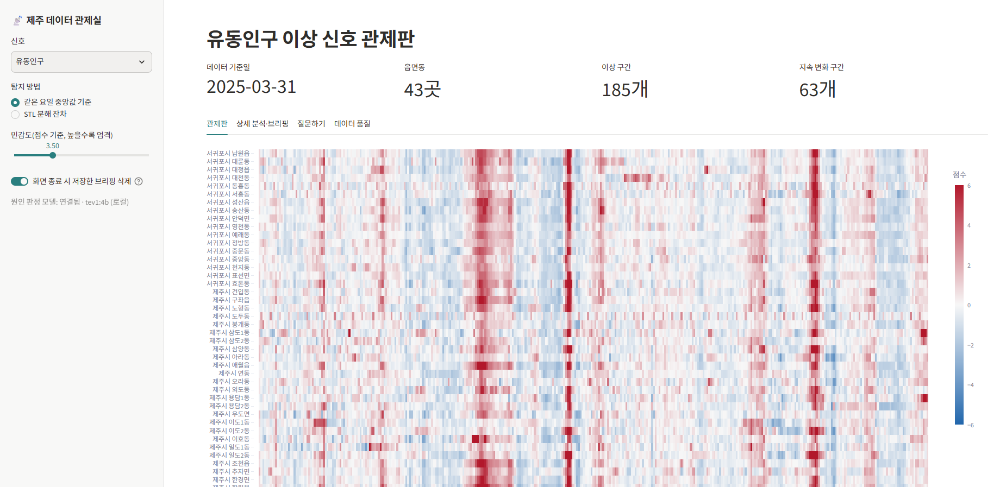
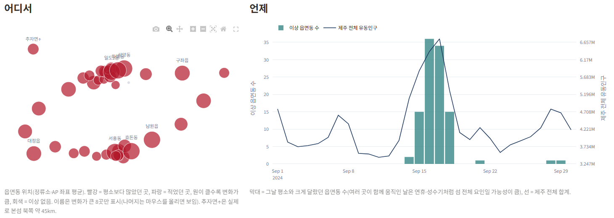

# 결과 설명서 — 제주 데이터 관제실

관광·교통 이상 신호 탐지·원인 설명 AI Agent · 팀 숨비소리 · 2026-11-12 기준

> 이 문서의 모든 수치는 zip에 들어 있는 코드와 데이터로 다시 만들 수 있습니다(8장 재현 방법). 확인하지 못한 것은 "미확인"으로 적었습니다.

## 0. 요약

- **무엇을 하나**
  - 제주 43개 읍면동의 내국인 유동인구·외국인 유동인구·와이파이·버스 이용을 매일 지켜봅니다(유동인구는 2024-04~2026-08).
  - 평소와 크게 다른 날을 찾습니다.
  - 같은 날의 날씨·공휴일·축제·입도객·다른 신호·인근 읍면동 변화, 작년 같은 시기 반복 여부를 근거로 원인 후보를 설명합니다. 외국인은 국적별로 누가 움직였는지도 나눠 봅니다.
- **어떻게 하나**
  - 숫자 계산은 코드가 합니다.
  - 질문 분류와 원인 판정은 센터 PC 안에서 도는 로컬 판단 모델(tev1:4b)이 합니다.
  - 답변의 숫자·날짜·근거 id는 검증기가 계산 결과와 대조합니다. 맞지 않으면 답변을 보여 주지 않습니다.
- **외부 전송 없음**: 분석·질문 중에는 외부로 데이터를 보내지 않습니다. 외부 AI API를 쓰지 않아 질문당 비용은 0원입니다.
- **확인한 것**
  - 가짜 이상을 넣는 평가에서 큰 변화(±80%)는 유동인구 89.6%, 버스 79.8%, 외국인 67.5%, 와이파이 58.3%를 찾았습니다.
  - 검증기는 오류 없는 브리핑을 100% 통과시키고, 숫자를 바꾼 브리핑의 87.3%를 막았습니다(놓친 것은 근거 안의 다른 값과 우연히 같은 경우).
  - 실제 이상 구간 1,262개 전체에 원인 판정을 돌려, 데이터로 따로 확인되는 사실(공휴일·축제·강한 비바람)이 있는 509개와 대조했습니다. 일치 88.2%(내국인 유동인구 97.4%, 외국인 56.5%), 그 근거를 지우면 그 원인을 고르지 않는 비율 100%입니다.
  - 실제 데이터 사례 9개 질문이 모두 검증을 통과했습니다.
  - 자동 테스트 177개가 통과합니다.
- **못 한 것**
  - 원인 판정의 정답은 판정에 넘긴 근거와 같은 자료에서 나온 약한 정답입니다. 현장에서 확인한 원인과 비교하지 못했습니다.
  - 센터 PC(i7-8700)에서 직접 재지 못했습니다. 6코어로 묶은 CPU에서 원인 질문 1건이 약 14초였습니다.

## 1. 문제 정의

**상황.** 제주데이터허브에는 읍면동 유동인구, 와이파이 이용, 정류소별 버스 이용 같은 일 단위 데이터가 공개되어 있습니다. 하지만 43개 읍면동 × 여러 신호를 매일 사람이 들여다보기는 어렵습니다. 이상한 날을 찾아도 이유를 알려면 기상·공휴일·축제·입도객 자료를 따로 찾아 날짜를 맞춰 봐야 합니다. 데이터 누락이 '급감'처럼 보이는 경우도 있습니다.

**대상 사용자(가정).** 데이터 분석 전문가가 아닌 관광·교통 업무 담당자와 센터 이용자입니다. 실제 사용자 인터뷰는 하지 않았으며, 대회 공고와 게시판 답변(센터 PC 사양·보안 정책)을 기준으로 정했습니다.

**목표.**

| 목표 | 이번 결과 |
|---|---|
| 43개 읍면동 × 4개 신호의 이상한 날을 자동으로 찾기 | 달성. 관제판 히트맵과 질문하기('7월에 이상했던 곳') |
| 이상의 원인 후보를 근거와 확률로 설명하기(단정 금지) | 달성. 근거 대조 + tev1 판정, 모든 답변에 "인과를 뜻하지 않습니다" 고정 |
| 틀린 숫자를 보여 주지 않기 | 달성. 검증기를 통과한 답변만 표시(5장 평가) |
| 센터 PC에서 외부 전송·비용 없이 돌리기 | 구조상 달성. 센터 PC 실측은 미확인(5.6절) |

## 2. 구조


**처리 순서** (`app/agent/local.py`)

1. **질문 분류.** tev1이 질문을 4종(이상 찾기·원인 설명·문서 질문·범위 밖)으로 나눕니다. 모델이 '범위 밖'이라 해도 키워드 규칙이 범위 안으로 보면 규칙을 따릅니다.
2. **조건 추출.** 규칙으로 읍면동(별칭·줄임말 포함)·날짜·기간·신호를 뽑습니다. 지역이 없으면 되묻습니다.
3. **도구 실행.** 질문 종류별로 정해진 순서대로 실행하고, 결과마다 id(R1, R2…)를 붙입니다.
4. **원인 판정.** 근거를 한국어 문장으로 풀어 tev1에 넘기면, tev1이 7개 원인 후보의 확률을 돌려줍니다.
5. **문장 작성.** 템플릿으로 문장을 만들고, 모든 문장에 근거 id를 붙입니다.
6. **검증.** 검증기가 문장의 숫자·날짜·근거 id·원인 표현을 도구 결과와 대조합니다. 하나라도 어긋나면 답변을 보류합니다.

**도구 7종** (`app/agent/tools.py`)

| 도구 | 하는 일 |
|---|---|
| detect_anomalies | 한 읍면동·신호의 이상일과 이상 구간(연속된 이상일 묶음) |
| scan_regions | 43개 읍면동을 모두 훑어 기간 안의 이상 구간을 점수 순으로 |
| find_co_movements | 같은 날 같은 읍면동의 다른 신호, 해당 읍면동을 뺀 제주 전체 합계, 인근 읍면동(가까운 3곳, 15km 이내) 합계가 함께 움직였는지 |
| check_context | 같은 날의 기상(강수·강풍), 공휴일(전날·당일·다음날, 외국인 신호는 중국·일본 공휴일), 지명이 명시된 축제, 그 달 입도객 성수기·비수기, 작년 같은 시기 반복 여부. 근거 자료 제공 기간 밖이면 '확인 불가' |
| nationality_mix | 외국인 신호가 크게 바뀐 날, 국적별로 평소보다 얼마나 늘거나 줄었는지와 전체 변화 중 비중 |
| search_docs | 데이터 명세서·허브 API 문서·반출 기준·게시판 답변·우리 문서 검색(BM25, 출처 포함) |
| get_series | 시계열 조회 |

**이상 탐지 방법** (`app/analytics/detect.py`)

- **기본: 같은 요일 기준(seasonal_z).** 앞뒤 4주의 같은 요일 값 중앙값을 기대값으로 두고, 잔차를 MAD로 표준화한 점수가 3.5 이상이면 이상일입니다.
- **선택: STL 분해 잔차(robust_resid).** 화면에서 고를 수 있습니다.
- **기본값을 같은 요일 기준으로 둔 이유.** 같은 경보 빈도에서 두 방법의 재현율 차이가 작았고(5.1절), 사용자에게 "같은 요일 평소 값보다 몇 % 많았다"로 설명하기 쉽습니다.

**사용 모델·라이브러리**

| 구분 | 내용 |
|---|---|
| 판단 모델 | tev1:4b (Ollama 공식 라이브러리, 약 4.3B, Q8 4.6GB, Apache 2.0). 보기 중 하나를 고르고 보기별 확률을 돌려주는 판단 전용 모델 |
| 판단 모델이 없을 때 | 규칙 기반 분류·판정으로 자동 전환(화면에 "규칙 기반" 표시) |
| 실행 환경 | Python 3.12, Streamlit 화면(127.0.0.1:8501), Ollama(127.0.0.1:11434) |
| 주요 라이브러리 | pandas, numpy, pyarrow, statsmodels(STL), holidays(공휴일), rank-bm25(문서 검색), plotly, streamlit, requests. 버전은 `requirements.txt`에 고정 |
| 외부 AI API | 사용하지 않음 |

## 3. 기능

화면은 4개 탭과 사이드바(신호·탐지 방법·민감도·저장 결과 삭제·판단 모델 연결 상태)로 되어 있습니다.

**① 관제판 — 기간 브리핑.** 기간(월)을 고르면 그 기간에 무엇이·어디서·언제 달라졌는지 한 화면에 보여 줍니다(기본값은 데이터의 마지막 달).
- **요약 숫자**: 이 기간 이상 구간 수, 그중 지속 변화, 이상이 난 읍면동 수, 이상 읍면동이 가장 많은 날
- **주요 이상 TOP 5**: 점수(평소 변동폭 대비 크기) 순으로 읍면동·기간·기대값 대비 %와 원인 후보, 근거 한 줄(예: "추석 전날 / 제주 전체 유동인구도 함께 증가")을 카드로 보여 줍니다. 이 원인 후보는 화면을 빨리 띄우려고 규칙으로 정한 '빠른 판정'이며, '상세 보기'를 누르면 상세 분석 탭에 그 구간이 선택되어 판정 모델(tev1)의 판정과 검증된 브리핑을 볼 수 있습니다.
- **어디서**: 읍면동 위치에 원을 그려, 평소보다 많았던 곳은 빨강, 적었던 곳은 파랑, 변화가 클수록 크게 표시합니다.
- **언제**: 날짜별로 평소와 크게 달랐던 읍면동 수(막대)와 제주 전체 합계(선)를 겹쳐 그립니다. 여러 곳이 함께 움직인 날은 연휴·성수기처럼 섬 전체 요인일 가능성이 큽니다.
- 읍면동 × 날짜 점수 지도(기준을 넘은 칸만 색칠)와 이상 구간 전체 목록은 접어 두었습니다.

예: 2024년 9월을 고르면 이상 구간 41개, 43곳 중 39곳에서 이상이 났고, 가장 많은 날은 2024-09-16(36곳, 추석 전날)입니다. TOP 5가 모두 추석 연휴 구간이며 원인 후보는 '공휴일·연휴'입니다. 전체 기간(2024-04~2026-08) 기준으로는 유동인구 이상 구간 581개, 그중 지속 변화 211개입니다(외국인 468개, 지속 43개).





**② 상세 분석·브리핑.**
- 이상 구간을 고르면 다음을 보여 줍니다.
  - 실제 값·기대값 그래프
  - 같은 날 맥락(근거 자료 제공 기간 밖이면 '확인 불가')
  - 다른 신호·제주 전체·인근 읍면동의 동반 변화
  - 외국인 신호는 국적별 변화
  - tev1의 원인 판정
- '판정 모델에 넘긴 근거' 펼침에서 모델이 본 문장을 그대로 확인할 수 있습니다.
- 검증된 브리핑은 HTML로 저장할 수 있습니다. 사이드바 '화면 종료 시 삭제'가 켜져 있으면(기본값) 종료할 때 지워집니다.


**③ 질문하기.** 자연어로 묻습니다(예: "이호동 2024년 7월 28일에 왜 사람이 많았어?", 연도를 빼면 데이터 기간 안의 가장 최근 해로 봅니다). 화면에는 다음이 표시됩니다.
- 분류 결과와 확률
- 추출한 지역·날짜
- 검증 통과 여부
- 근거 id가 붙은 답변

그 아래 '근거' 펼침에서 도구 결과 전체를 볼 수 있습니다.


**④ 데이터 품질.** 신호별 수집 기간, 빈 날, 버스 이용의 읍면동 연결 비율(87.9%) 등을 보여 줍니다.

## 4. 실행 결과 — 실제 데이터 사례

허브 Open API로 받은 실제 데이터(유동인구 2024-04~2026-08)로 질문 9개를 넣은 결과입니다. 원문은 `eval/results/real_cases.md`에 있습니다.

| 질문 | Agent 판정 | 데이터로 확인되는 실제 원인 | 검증 |
|---|---|---|---|
| 성산읍 2024년 9월 16일에 유동인구가 왜 늘었어? | 공휴일·연휴 81.3% | 추석 연휴(공휴일 데이터) | 통과 |
| 이호동 2024년 7월 28일에 왜 사람이 많았어? | 관광 수요 변화 64.7% | 미확인(여름 주말, 축제 데이터에 해당 행사 없음) | 통과 |
| 이호동 2024년 8월 2일에 사람이 왜 많았어? | 축제·행사 56.8% | 이호테우축제 첫날(축제 데이터 761) | 통과 |
| 삼도1동 2025년 3월 29일에 사람이 왜 많았어? | 관광 수요 변화 61.1% | 미확인(축제 데이터에 맞는 행사 없음) | 통과 |
| 송산동 2024년 9월 29일에 외국인이 왜 이렇게 많았어? | 판단 불가 93.5% | 미확인(국적별로는 일본이 변화의 73.1%) | 통과 |
| 우도면 2025년 8월 1일에 사람이 왜 많았어? | 관광 수요 변화 71.6% | 미확인(여름 휴가철, 기상·축제 자료 제공 기간 밖) | 통과 |
| 2024년 9월에 유동인구가 이상하게 많았던 곳 알려줘 | 43곳 중 39곳, 이상 구간 41개(추석 전후 집중) | - | 통과 |
| 반출 가능한 데이터 기준이 뭐야? | 문서 3건 인용(게시판 답변 §3 포함) | - | 통과 |
| 오늘 점심 메뉴 추천해줘 | 범위 밖 안내 | - | 통과 |

**답변 예 1 — 성산읍 추석** (그대로 옮김)

```text
서귀포시 성산읍 유동인구에서 이상 구간 1개(이상일 3일)가 확인됐습니다 [R1].
2024-09-15~2024-09-17(지속 변화): 가장 큰 날 2024-09-16 값은 310,756.0명으로 기대값 124,968.5보다 148.7% 많았습니다 [R1].
같은 날 확인된 맥락은 추석 전날 (당일, 2024-09-16), 추석 (다음날, 2024-09-17)이며 원인 후보로 볼 수 있습니다 [R3].
같은 시기 제주 전체 유동인구도 2024-09-17에 평소보다 많았습니다(점수 8.75) [R2].
같은 시기 인근 읍면동 유동인구도 2024-09-17에 평소보다 많았습니다(점수 8.2) [R2].
근거를 종합한 원인 후보는 '공휴일·연휴'(확률 81.3%, 확신도 상)입니다 [R4][R2][R3].
이는 상관에 기반한 후보이며 인과를 뜻하지 않습니다.
```

**답변 예 2 — 우도면 2025년 여름** (근거 자료가 끝난 뒤의 날짜)

```text
제주시 우도면 유동인구에서 이상 구간 1개(이상일 3일)가 확인됐습니다 [R1].
2025-07-31~2025-08-02(지속 변화): 가장 큰 날 2025-08-01 값은 45,903.0명으로 기대값 20,480.5보다 124.1% 많았습니다 [R1].
같은 날 확인된 맥락은 작년 같은 시기(2024-08-01)에도 유동인구 평소보다 많았음(점수 5.30), 매년 반복되는 변화일 수 있음이며 원인 후보로 볼 수 있습니다 [R3].
이 날짜는 기상·축제·행사·입도객 자료 제공 기간 밖이라 확인하지 못했습니다 [R3].
같은 시기 제주 전체 유동인구도 2025-07-31에 평소보다 많았습니다(점수 5.7) [R2].
같은 시기 인근 읍면동 유동인구도 2025-07-31에 평소보다 많았습니다(점수 6.04) [R2].
근거를 종합한 원인 후보는 '관광 수요 변화'(확률 71.6%, 확신도 상)입니다 [R4][R2][R3].
이는 상관에 기반한 후보이며 인과를 뜻하지 않습니다.
```

허브의 기상·축제 자료는 2025-03에서 끝납니다. 그 뒤 날짜는 "없음"이 아니라 "확인하지 못했습니다"로 적어, 근거가 없는 것과 확인할 수 없는 것을 구분합니다.

**답변 예 3 — 송산동 외국인** (근거가 부족한 경우)

```text
2024-09-29(일시 급변): 가장 큰 날 2024-09-29 값은 6,805.0명으로 기대값 1,369.5보다 396.9% 많았습니다 [R1].
국적별로는 일본이 평소보다 4,136.0명 많아 전체 변화의 73.1%를 차지했습니다 [R4].
근거를 종합한 원인 후보는 '판단 불가'(확률 93.5%, 확신도 상)입니다 [R5][R2][R3].
```

누가 움직였는지(일본 국적)는 데이터로 보이지만, 왜인지(행사·크루즈 일정 등)는 일 단위 데이터가 없어 '판단 불가'로 답합니다. 크루즈 기항 데이터(허브 319)는 연도별 합계라 쓰지 못했습니다.

## 5. 검증

### 5.1 이상 탐지 — 가짜 이상 주입 (`eval/inject_eval.py`)

**방법.**
- 신호별 실제 시계열의 임의 날짜에 ±20/40/80% 변화를 넣었습니다. 1일 급변과 4일 지속 변화를 섞어 480회입니다.
- 기본값(같은 요일 기준, 점수 3.5)이 그 날을 이상일로 잡는 비율을 쟀습니다.
- 경보 빈도는 주입하지 않은 실제 데이터에서 이상일로 표시되는 비율입니다.

| 신호 | ±20% | ±40% | ±80% | 전체 | 평소 경보(100일당) |
|---|---|---|---|---|---|
| 유동인구(43곳, 2024-04~2026-08) | 17.8% | 57.8% | **89.6%** | 55.1% | 4.1일 |
| 버스(41곳, 3개월) | 0.8% | 14.8% | **79.8%** | 31.8% | 3.6일 |
| 외국인(43곳, 2024-04~2026-08, 2025-04·05 없음) | 6.9% | 34.7% | **67.5%** | 36.4% | 1.9일 |
| 와이파이(43곳, 6개월) | 1.1% | 9.8% | **58.3%** | 23.1% | 3.2일 |

- **해석.** 큰 변화는 대부분 잡지만, 작은 변화(±20%)는 거의 놓칩니다. 와이파이·외국인은 평소 변동이 커서(외국인은 읍면동별 인원이 작음) 큰 변화도 58~68%만 잡습니다.
- **기간 연장.** 유동인구를 1년치(2024-04~2025-03)에서 2026-08까지 늘리자 평소 경보가 100일당 2.8일에서 4.1일로 늘었습니다. 월별로 보면 2025-10 추석·개천절 7일 연휴(17.4%), 2025-05 연휴, 2026-02 설에 몰려 있어 실제 급증이 늘어난 것입니다. 1년치 결과는 `eval/results/_1year/`에 남겼습니다.
- **방법 비교.** 같은 경보 빈도에서 STL 잔차 방법과의 재현율 차이는 유동인구 +2.1%p, 와이파이 +5.5%p, 버스 −0.9%p로 작습니다.
- **조절.** 민감도(점수 기준)는 화면에서 바꿀 수 있습니다.

### 5.2 숫자 검증기 — 오류 주입 (`eval/verify_eval.py`)

실제 데이터로 만든 브리핑 60개에 오류를 넣고, 검증기가 막는 비율을 쟀습니다.

| 오류 종류 | 막은 비율 |
|---|---|
| 오류 없는 브리핑(통과해야 함) | 100% 통과 |
| 숫자 변경 | 87.3% (55건) |
| 근거 바꿔치기(다른 결과 id 인용) | 91.3% (23건 중 21) |
| 근거 삭제, 지어낸 숫자, 근거 없는 원인 단정 | 100% (각 60건) |

놓친 경우는 다음과 같습니다.
- **숫자 변경:** 바뀐 숫자가 근거 안의 다른 숫자와 우연히 같을 때. 놓친 7건은 모두 '이상 구간 2개 → 4개'처럼 작은 정수이거나, 같은 결과에 들어 있는 다른 이상일로 날짜가 바뀐 경우였습니다. 기간을 늘린 뒤 브리핑 표본이 바뀌어 1년치(94.3%, 53건)보다 낮게 나왔습니다.
- **근거 바꿔치기:** 두 결과에 같은 날짜가 있을 때.

### 5.3 질문 분류 (`eval/intent_probe.py`)

| 질문 묶음 | tev1:4b | tev1:0.8b | 키워드 규칙 | 모델+규칙(사용 중) |
|---|---|---|---|---|
| 처음 보는 질문 12개(설계 전에 적어 둠) | 83% | 58% | 33% | 83% |
| 설계에 쓴 질문 24개 | 88% | - | 92% | 96% |

### 5.4 원인 판정 (`eval/tev1_probe.py`)

**손수 만든 사례 10건(정답을 미리 정함).** tev1:4b는 10/10, tev1:0.8b는 5~6/10입니다. 사례는 기상·연휴·축제·관광 수요·데이터 오류·판단 불가로 구성했습니다.

**실제 사례(4장).**
- 정답을 확인할 수 있는 2건은 맞혔습니다.
  - 추석 → 공휴일·연휴
  - 이호테우축제 → 축제·행사
- 나머지 2건은 실제 원인을 확인할 수 없어 채점하지 않았습니다.

**실제 이상 구간 전체 — 약한 정답 평가 (`eval/judge_eval.py`).**
- **방법.** 4개 신호의 실제 이상 구간 1,262개 전체에 판정을 돌렸습니다. 판정과 따로 데이터에서 확인되는 사실이 있으면 그것을 '약한 정답'으로 삼았습니다.
  - 공휴일: 가장 큰 날의 전날·당일·다음날이 공휴일(외국인 신호는 중국·일본 공휴일)
  - 축제: 그 읍면동 이름이 행사명에 명시된 행사 기간
  - 날씨: 일강수량 30mm 이상 또는 최대풍속 14m/s 이상이고 '감소'
- **근거 제거 시험.** 정답의 근거가 된 맥락만 지우고 다시 판정해, 그 원인을 고르지 않는지 봤습니다(근거 없이 원인을 지어내지 않는가).

| 대상 | 정답 있는 구간 | 일치 | 근거 제거 시 그 원인을 안 고름 |
|---|---|---|---|
| 전체 | 509 | **88.2%** | 100% |
| 내국인 유동인구 | 343 | 97.4% | 100% |
| 버스 | 36 | 94.4% | 100% |
| 와이파이 | 22 | 90.9% | 100% |
| 외국인 | 108 | 56.5% | 100% |
| (원인별) 공휴일 / 축제 / 날씨 | 498 / 3 / 16 | 89.6% / 100% / 43.8% | 100% |

- **외국인이 낮은 이유.** 한국 공휴일 앞뒤에 급증이 나타나는 비율은 내국인이 평소의 9.4배인데, 외국인은 1.1배로 거의 차이가 없었습니다. 그래서 외국인 신호에는 국적별로 관계가 보인 중국 공휴일(중국인 1.7배)·일본 공휴일(일본인 2.3배)을 넘기도록 바꿨습니다. 그래도 관계가 약해 '공휴일이 겹치면 정답은 공휴일'이라는 약한 정답 자체가 외국인에게는 잘 맞지 않습니다. 인근 읍면동이 함께 움직였으면 판정은 '관광 수요 변화'를 고르는 경우가 많았습니다.
- **평가를 보고 바꾼 것(공개).**
  - 1년치 평가에서 근거 문장에 맥락 종류(날씨·공휴일 등)를 붙였습니다. 81.5%에서 95.2%가 됐습니다.
  - 기간 연장 평가에서 외국인 공휴일 근거를 중국·일본으로 바꿨습니다. 전체 90.9%(464건)에서 88.2%(509건)가 됐고, 외국인 정답 구간이 늘어 일치율이 낮아졌습니다.
  - 그 뒤로는 정답이나 판정을 결과에 맞춰 더 고치지 않았습니다. 바꾸기 전 결과도 모두 남겼습니다(`eval/results/judge_eval_before_foreign_holiday.json`, `eval/results/_1year/`).
- **한계.** 정답이 판정에 넘기는 근거와 같은 자료에서 나옵니다. 그래서 이 평가는 '근거를 제대로 읽는가'를 재며, 현장에서 확인한 원인과 비교한 것이 아닙니다. 규칙 판정의 일치율이 95.7%로 더 높은 것은 규칙이 약한 정답을 만드는 방식과 거의 같기 때문입니다.
- **정답이 없는 구간.** 근거 자료 기간 안 256개 중 판정은 관광 수요 변화 151개, 판단 불가 105개였습니다. 근거가 없는데 날씨·축제를 고른 경우는 없었습니다.

### 5.5 문서 검색 (`eval/rag_probe.py`)

질문마다 답이 들어 있는 문서를 미리 정하고, 상위 3개 안에 들어오는지 봤습니다.

| 질문 묶음 | 개선 전 | 개선 후 |
|---|---|---|
| 설계 질문 10개 | 7/10 | 9/10 |
| 따로 둔 질문 6개 | 5/6 | 6/6 |

**설계 질문의 출처.** 11/11 실제 사례 점검에서 "반출 기준" 질문에 재무 명세서가 먼저 나온 것을 보고 만든 질문입니다.

**개선 내용.**
- 제목 가중
- 우리 문서(데이터 활용 명세·설치 매뉴얼) 추가
- 문서당 조각 하나만 표시

### 5.6 처리 시간 (`eval/speed_probe.py`)

실제 데이터로 질문 6종을 2번씩 넣어, 질문을 받은 때부터 검증된 답변까지의 시간을 쟀습니다(중앙값).

| 조건(모두 개발 PC i7-13700K) | 원인 질문 | 지역 훑기 | 문서·범위 밖 |
|---|---|---|---|
| CPU를 센터 PC와 같은 6코어로 묶음(GPU 끔) | 13.7초 | 4.7초 | 4.3초 |
| CPU 제한 없음(GPU 끔, 1년치 데이터로 측정) | 8.4초 | 3.1초 | 약 3초 |
| GPU 사용 | 1.0초 | 0.7초 | 0.5초 |
| 판단 모델 없음(규칙 기반) | 2.9초 | 1.6초 | 1.4초 |

- **기간 연장 뒤.** 2024-04~2026-08·신호 4종으로 다시 쟀습니다(CPU 제한 없음은 다시 재지 않음). 6코어 기준 원인 질문 중앙값은 13.7초로 같았고, 가장 느린 질문은 15.7초(1년치 14.6초)였습니다.

- **센터 PC 조건.** GTX 1060은 VRAM이 3GB라 tev1:4b(4.6GB)가 다 올라가지 않으므로, 센터 PC에서는 CPU 행에 가깝다고 봅니다. 센터 PC는 코어당 성능이 개발 PC보다 낮아 더 느릴 수 있습니다. **실측은 미확인입니다.**
- **첫 질문.** 모델을 메모리에 올리느라 몇 초 더 걸립니다.

### 5.7 자동 테스트

- **테스트 수.** `python -m pytest` 기준 177개가 통과합니다. 대상은 수집기·탐지·근거·검증기·Agent·화면 스모크 테스트입니다.
- **수정 방식.** 1년치 데이터 점검과 사례 실행에서 찾은 문제는 각각 재현 테스트를 먼저 만들고 고쳤습니다.
  - 섬 전체 비교에 해당 지역이 섞이던 문제
  - 반대 방향 맥락을 원인 후보로 적던 문제
  - 지명 속 숫자를 근거로 인정하던 문제
  - 문서 속 한국어 날짜를 막던 문제
  - 서버 오류로 수집이 멈추면 그날 받은 달이 저장되지 않던 문제
  - 외국인 신호에 한국 공휴일을 근거로 넘기던 문제
  - 판단 모델 주소(기본 11434)에 Ollama가 아닌 다른 프로그램이 있어도 질문·근거를 보내던 문제(설치 재현 중 발견 → 확인된 tev1 Ollama에만 보냄)
- **설치 재현(11/12).** 제출 폴더를 압축해 빈 폴더에 풀고 `install.bat`을 실행했습니다(2회, 145~155초, 개발 PC). 그 폴더에서 테스트가 모두 통과했고, 판단 모델이 없는 규칙 모드와 모델 모드 모두 질문 답변이 검증을 통과했습니다. 첫 화면이 뜨기까지 약 35초 걸렸습니다.

## 6. 한계

- **원인은 후보일 뿐입니다.** 동반 변화·맥락은 상관관계이며 인과가 아닙니다. 그래서 "원인 후보 + 근거 + 확률"로만 표현합니다.
- **원인 판정의 정답이 약합니다.** 실제 이상 구간 1,262개로 채점했지만, 정답은 판정 근거와 같은 자료에서 나온 약한 정답입니다. 외국인 신호는 일치율이 56.5%로 낮습니다. 판정 모델에 넘긴 근거 문장은 화면에 그대로 보여 줍니다.
- **작은 변화는 놓칩니다.** ±20% 변화는 대부분 놓치고, 와이파이·외국인은 큰 변화도 58~68%만 잡습니다.
- **근거 자료의 기간이 신호보다 짧습니다.** 유동인구(내국인·외국인)는 2024-04~2026-08이지만, 허브 기상·축제는 2025-03, 입도객은 2025-07에서 끝납니다. 그 뒤 날짜는 해당 근거를 '확인 불가'로 표시합니다. 와이파이는 6개월, 버스는 3개월뿐입니다.
- **외국인 유동인구 두 달이 빠졌습니다.** 허브 589의 2025-04·05는 값이 수십억으로 잘못 들어 있어 API가 오류를 돌려줍니다(하루 70행, 정상은 약 400행). 받을 수 없어 빈 값으로 두었습니다.
- **축제·버스 연결이 일부입니다.** 축제 데이터에 장소 항목이 없어, 행사명에 지명이 명시된 9건만 읍면동에 연결했습니다. 버스 이용자 12.1%는 읍면동에 연결하지 못했습니다(데이터 품질 탭에 공개).
- **검증기는 문장의 뜻까지 보장하지 않습니다.** 숫자·날짜·근거 id를 대조할 뿐입니다. 문서 검색은 질문에 따라 관련이 적은 문서가 함께 나올 수 있습니다(예: "반출 기준"에 재무 명세서가 1순위).
- **센터 데이터 CSV 입력은 이번 버전에 없습니다.** 지금은 허브 공개 데이터만 씁니다.
- **센터 PC 실측 속도는 미확인입니다.**

## 7. 센터 활용 방안

| 누가 | 언제 | 어떻게 |
|---|---|---|
| 관광·교통 업무 담당자 | 매주 | 관제판에서 지난주 이상 구간 확인 → 상세 분석 → 검증된 브리핑을 HTML로 저장해 보고 자료로 사용 |
| 행사·정책 담당자 | 행사·연휴 후 | "○○동 ○월 ○일에 왜?"로 행사 기간 변화와 근거 확인. 원인이 '미확인'이면 현장 정보로 보완 |
| 데이터 담당자 | 수집 후 | 데이터 품질 탭과 '데이터 오류' 판정으로 누락·이상값 점검 |
| 센터 이용자 | 분석 전 | 질문하기의 문서 검색으로 데이터 항목·반출 기준·API 사용법 확인(출처 위치 포함) |

**운영 조건**
- **설치.** Python 3.12와 Ollama를 설치한 뒤 `install.bat`, `run.bat`을 실행합니다. 비전공자용 단계별 안내는 `docs/설치_실행_매뉴얼.md`에 있습니다.
- **외부 접속.** 설치할 때만 python.org·pypi.org·ollama.com, 데이터 갱신할 때만 open.jejudatahub.net에 접속합니다. **분석·질문 중에는 외부 접속이 없습니다.**
- **비용.** 외부 AI API를 쓰지 않아 0원입니다.
- **결과 보존.** 저장한 브리핑은 `data/results`에 남고, '화면 종료 시 삭제'(기본 ON)로 퇴실 시 삭제 원칙을 따릅니다.

**다음 버전에서 넓힐 것**
- 센터 반출 CSV(월 단위) 입력
- 이상 발생 알림
- 원인 판정 정답 사례 모으기(담당자가 '맞음/틀림'을 남기는 기능) — 지금의 약한 정답을 대신할 실제 정답
- 외국인 신호의 원인 근거(크루즈 기항·항공편 일 단위 자료를 구할 수 있으면)

## 8. 재현 방법

모든 명령은 프로젝트 폴더에서 `.venv\Scripts\python.exe -m ...`로 실행합니다. 판단 모델이 필요한 평가는 Ollama와 `tev1:4b`가 켜져 있어야 합니다.

| 결과 | 명령 | 결과 파일 |
|---|---|---|
| 화면 실행 | `run.bat` | 브라우저 127.0.0.1:8501 |
| 자동 테스트 177개 | `python -m pytest` | 화면 출력 |
| 5.1 이상 탐지 | `python -m eval.inject_eval --signal 유동인구` (와이파이·버스·외국인도 같은 방식) | `eval/results/inject_eval_<신호>.json` |
| 5.2 숫자 검증기 | `python -m eval.verify_eval` | `eval/results/verify_eval.json` |
| 5.3 질문 분류 | `python -m eval.intent_probe --model tev1:4b --host http://127.0.0.1:11434` | `eval/results/intent_probe_tev1_4b.json` |
| 5.4 원인 판정(사례 10건) | `python -m eval.tev1_probe --model tev1:4b --host http://127.0.0.1:11434` | `eval/results/tev1_probe_*.json` |
| 5.4 원인 판정(실제 이상 구간 전체) | `python -m eval.judge_eval --host http://127.0.0.1:11434 --signals 유동인구,와이파이,버스,외국인` | `eval/results/judge_eval.json` |
| 5.5 문서 검색 | `python -m eval.rag_probe` | `eval/results/rag_probe_*.json` |
| 5.6 처리 시간 | `python -m eval.speed_probe --host http://127.0.0.1:11434 --tag <이름> [--pin 0x555]` | `eval/results/speed_probe_<이름>.json` |
| 4장 실제 사례 | `python -m eval.real_cases --host http://127.0.0.1:11434` | `eval/results/real_cases.md` |
| 과정 기록 | `notebooks/01~06` (실행 결과 포함, 06이 기간 연장·외국인·판정 평가) | - |

데이터는 `data/cache`의 parquet(허브 Open API 수집본)를 씁니다. 새로 받으려면 `.env`에 허브 프로젝트 키를 넣고 `python -m app.ingest.plan`을 실행합니다(키는 zip에 없음).

## 9. 평가 기준별 확인 위치

| 평가 항목 | 확인할 곳 |
|---|---|
| 분석 주제 타당성·창의성 | 1장 문제 정의, 기획서 1~2장 |
| 필수 데이터 활용 적절성 | `docs/데이터_활용_명세.md`(허브 데이터 14종 수집·10종 사용, 항목·전처리·이용조건), 데이터 품질 탭 |
| AI Agent 기술성·완성도 | 2장 구조, 5장 검증, 자동 테스트 177개 |
| 편의성·실용성 | 3장 기능, `docs/설치_실행_매뉴얼.md`, 5.6 처리 시간, 7장 활용 방안 |
| 결과 신뢰성·재현성 | 5장(평가 방법과 수치), 6장 한계, 8장 재현 명령 |

## 부록. AI 도구·데이터·오픈소스 고지

- **개발 도구.** AI 코딩 도구(Anthropic Claude Code)로 코드·테스트·문서 작성을 보조받았습니다. 실행되는 서비스에는 포함되지 않습니다.
- **서비스에서 쓰는 모델.** tev1:4b(Ollama 공식 라이브러리, Apache 2.0)뿐입니다. 외부 AI API는 쓰지 않습니다.
- **데이터.** 제주데이터허브 Open API·파일과 제주빅데이터센터 데이터명세서(공개 자료)를 썼습니다. 출처·전처리·이용조건은 `docs/데이터_활용_명세.md`에 있습니다. 허브 데이터목록 파일은 배포 금지 대상이라 포함하지 않았습니다.
- **오픈소스.** `requirements.txt`의 패키지(버전 고정)를 썼고, 공휴일은 `holidays` 패키지로 판단합니다.
