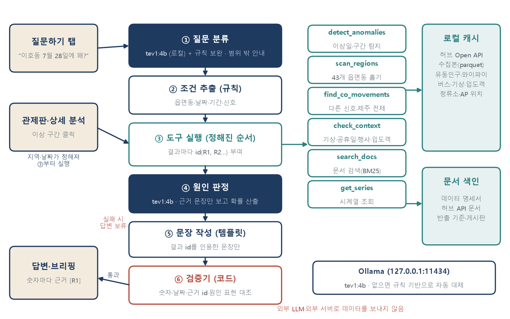
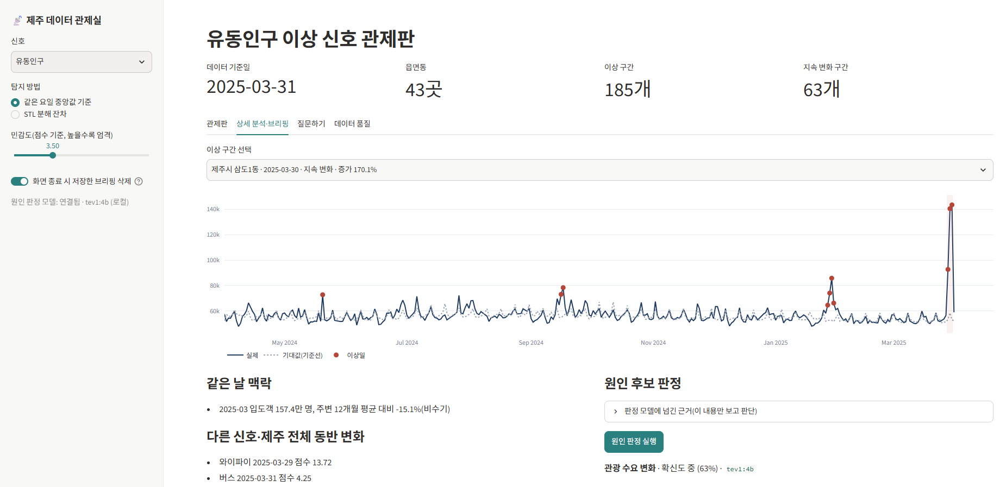
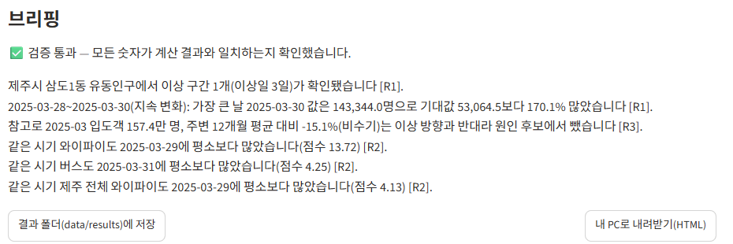
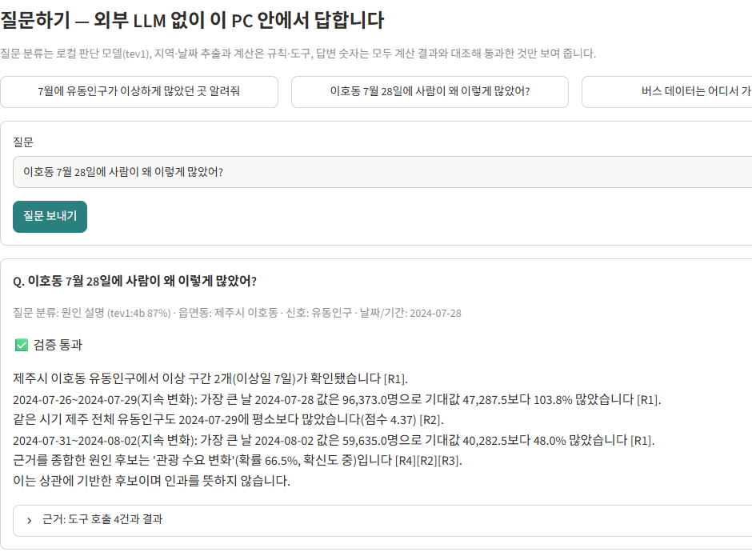

# 결과 설명서 — 제주 데이터 관제실

관광·교통 이상 신호 탐지·원인 설명 AI Agent · 팀 숨비소리 · 2026-11-11 기준

> 이 문서의 모든 수치는 zip에 들어 있는 코드와 데이터로 다시 만들 수 있습니다(8장 재현 방법). 확인하지 못한 것은 "미확인"으로 적었습니다.

## 0. 요약

- **무엇을 하나**
  - 제주 43개 읍면동의 유동인구·와이파이·버스 이용을 매일 지켜봅니다.
  - 평소와 크게 다른 날을 찾습니다.
  - 같은 날의 날씨·공휴일·축제·입도객·다른 신호 변화를 근거로 원인 후보를 설명합니다.
- **어떻게 하나**
  - 숫자 계산은 코드가 합니다.
  - 질문 분류와 원인 판정은 센터 PC 안에서 도는 로컬 판단 모델(tev1:4b)이 합니다.
  - 답변의 숫자·날짜·근거 id는 검증기가 계산 결과와 대조합니다. 맞지 않으면 답변을 보여 주지 않습니다.
- **외부 전송 없음**: 분석·질문 중에는 외부로 데이터를 보내지 않습니다. 외부 AI API를 쓰지 않아 질문당 비용은 0원입니다.
- **확인한 것**
  - 가짜 이상을 넣는 평가에서 큰 변화(±80%)는 유동인구 88.4%, 버스 79.8%, 와이파이 58.3%를 찾았습니다.
  - 검증기는 오류 없는 브리핑을 100% 통과시키고, 숫자를 바꾼 브리핑의 94.3%를 막았습니다.
  - 실제 데이터 사례 7개 질문이 모두 검증을 통과했습니다.
  - 자동 테스트 147개가 통과합니다.
- **못 한 것**
  - 원인 판정을 실제 사례로 대규모 채점하지 못했습니다.
  - 센터 PC(i7-8700)에서 직접 재지 못했습니다. 6코어로 묶은 CPU에서 원인 질문 1건이 약 14초였습니다.

## 1. 문제 정의

**상황.** 제주데이터허브에는 읍면동 유동인구, 와이파이 이용, 정류소별 버스 이용 같은 일 단위 데이터가 공개되어 있습니다. 하지만 43개 읍면동 × 여러 신호를 매일 사람이 들여다보기는 어렵습니다. 이상한 날을 찾아도 이유를 알려면 기상·공휴일·축제·입도객 자료를 따로 찾아 날짜를 맞춰 봐야 합니다. 데이터 누락이 '급감'처럼 보이는 경우도 있습니다.

**대상 사용자(가정).** 데이터 분석 전문가가 아닌 관광·교통 업무 담당자와 센터 이용자입니다. 실제 사용자 인터뷰는 하지 않았으며, 대회 공고와 게시판 답변(센터 PC 사양·보안 정책)을 기준으로 정했습니다.

**목표.**

| 목표 | 이번 결과 |
|---|---|
| 43개 읍면동 × 3개 신호의 이상한 날을 자동으로 찾기 | 달성. 관제판 히트맵과 질문하기('7월에 이상했던 곳') |
| 이상의 원인 후보를 근거와 확률로 설명하기(단정 금지) | 달성. 근거 대조 + tev1 판정, 모든 답변에 "인과를 뜻하지 않습니다" 고정 |
| 틀린 숫자를 보여 주지 않기 | 달성. 검증기를 통과한 답변만 표시(5장 평가) |
| 센터 PC에서 외부 전송·비용 없이 돌리기 | 구조상 달성. 센터 PC 실측은 미확인(5.6절) |

## 2. 구조



**처리 순서** (`app/agent/local.py`)

1. **질문 분류.** tev1이 질문을 4종(이상 찾기·원인 설명·문서 질문·범위 밖)으로 나눕니다. 모델이 '범위 밖'이라 해도 키워드 규칙이 범위 안으로 보면 규칙을 따릅니다.
2. **조건 추출.** 규칙으로 읍면동(별칭·줄임말 포함)·날짜·기간·신호를 뽑습니다. 지역이 없으면 되묻습니다.
3. **도구 실행.** 질문 종류별로 정해진 순서대로 실행하고, 결과마다 id(R1, R2…)를 붙입니다.
4. **원인 판정.** 근거를 한국어 문장으로 풀어 tev1에 넘기면, tev1이 7개 원인 후보의 확률을 돌려줍니다.
5. **문장 작성.** 템플릿으로 문장을 만들고, 모든 문장에 근거 id를 붙입니다.
6. **검증.** 검증기가 문장의 숫자·날짜·근거 id·원인 표현을 도구 결과와 대조합니다. 하나라도 어긋나면 답변을 보류합니다.

**도구 6종** (`app/agent/tools.py`)

| 도구 | 하는 일 |
|---|---|
| detect_anomalies | 한 읍면동·신호의 이상일과 이상 구간(연속된 이상일 묶음) |
| scan_regions | 43개 읍면동을 모두 훑어 기간 안의 이상 구간을 점수 순으로 |
| find_co_movements | 같은 날 같은 읍면동의 다른 신호, 해당 읍면동을 뺀 제주 전체 합계가 함께 움직였는지 |
| check_context | 같은 날의 기상(강수·강풍), 공휴일(전날·당일·다음날), 지명이 명시된 축제, 그 달 입도객 성수기·비수기 |
| search_docs | 데이터 명세서·허브 API 문서·반출 기준·게시판 답변·우리 문서 검색(BM25, 출처 포함) |
| get_series | 시계열 조회 |

**이상 탐지 방법** (`app/analytics/detect.py`)

- **기본: 같은 요일 기준(seasonal_z).** 앞뒤 4주의 같은 요일 값 중앙값을 기대값으로 두고, 잔차를 MAD로 표준화한 점수가 3.5 이상이면 이상일입니다.
- **선택: STL 분해 잔차(robust_resid).** 화면에서 고를 수 있습니다.
- **기본값을 같은 요일 기준으로 둔 이유.** 같은 경보 빈도에서 두 방법의 재현율 차이가 작았고(5.1절), 사용자에게 "같은 요일 평소 값보다 몇 % 많았다"로 설명하기 쉽습니다.

**사용 모델·라이브러리**

| 구분 | 내용 |
|---|---|
| 판단 모델 | tev1:4b (Ollama 공식 라이브러리, 약 4.3B, Q8 4.6GB, Apache 2.0). 보기 중 하나를 고르고 보기별 확률을 돌려주는 판단 전용 모델 |
| 판단 모델이 없을 때 | 규칙 기반 분류·판정으로 자동 전환(화면에 "규칙 기반" 표시) |
| 실행 환경 | Python 3.12, Streamlit 화면(127.0.0.1:8501), Ollama(127.0.0.1:11434) |
| 주요 라이브러리 | pandas, numpy, pyarrow, statsmodels(STL), holidays(공휴일), rank-bm25(문서 검색), plotly, streamlit, requests. 버전은 `requirements.txt`에 고정 |
| 외부 AI API | 사용하지 않음 |

## 3. 기능

화면은 4개 탭과 사이드바(신호·탐지 방법·민감도·저장 결과 삭제·판단 모델 연결 상태)로 되어 있습니다.

**① 관제판.** 43개 읍면동 × 날짜 히트맵입니다. 빨강은 평소보다 많음, 파랑은 적음입니다. 유동인구 기본값 기준으로 이상 구간 185개, 그중 3일 이상 이어진 지속 변화 63개가 표시됩니다.


**② 상세 분석·브리핑.**
- 이상 구간을 고르면 다음을 보여 줍니다.
  - 실제 값·기대값 그래프
  - 같은 날 맥락
  - 다른 신호·제주 전체의 동반 변화
  - tev1의 원인 판정
- '판정 모델에 넘긴 근거' 펼침에서 모델이 본 문장을 그대로 확인할 수 있습니다.
- 검증된 브리핑은 HTML로 저장할 수 있습니다. 사이드바 '화면 종료 시 삭제'가 켜져 있으면(기본값) 종료할 때 지워집니다.





**③ 질문하기.** 자연어로 묻습니다(예: "이호동 7월 28일에 왜 사람이 많았어?"). 화면에는 다음이 표시됩니다.
- 분류 결과와 확률
- 추출한 지역·날짜
- 검증 통과 여부
- 근거 id가 붙은 답변

그 아래 '근거' 펼침에서 도구 결과 전체를 볼 수 있습니다.



**④ 데이터 품질.** 신호별 수집 기간, 빈 날, 버스 이용의 읍면동 연결 비율(87.9%) 등을 보여 줍니다.

## 4. 실행 결과 — 실제 데이터 사례

허브 Open API로 받은 실제 데이터(유동인구 2024-04~2025-03)로 질문 7개를 넣은 결과입니다. 원문은 `eval/results/real_cases.md`에 있습니다.

| 질문 | Agent 판정 | 데이터로 확인되는 실제 원인 | 검증 |
|---|---|---|---|
| 성산읍 2024년 9월 16일에 유동인구가 왜 늘었어? | 공휴일·연휴 73.4% | 추석 연휴(공휴일 데이터) | 통과 |
| 이호동 2024년 7월 28일에 왜 사람이 많았어? | 관광 수요 변화 66.5% | 미확인(여름 주말, 축제 데이터에 해당 행사 없음) | 통과 |
| 이호동 2024년 8월 2일에 사람이 왜 많았어? | 축제·행사 75.9% | 이호테우축제 첫날(축제 데이터 761) | 통과 |
| 삼도1동 2025년 3월 29일에 사람이 왜 많았어? | 관광 수요 변화 62.5% | 미확인(축제 데이터에 맞는 행사 없음) | 통과 |
| 2024년 9월에 유동인구가 이상하게 많았던 곳 알려줘 | 43곳 중 38곳, 이상 구간 39개(추석 전후 집중) | - | 통과 |
| 반출 가능한 데이터 기준이 뭐야? | 문서 3건 인용(게시판 답변 §3 포함) | - | 통과 |
| 오늘 점심 메뉴 추천해줘 | 범위 밖 안내 | - | 통과 |

**답변 예 1 — 성산읍 추석** (그대로 옮김)

```text
서귀포시 성산읍 유동인구에서 이상 구간 1개(이상일 3일)가 확인됐습니다 [R1].
2024-09-15~2024-09-17(지속 변화): 가장 큰 날 2024-09-16 값은 310,756.0명으로 기대값 124,968.5보다 148.7% 많았습니다 [R1].
같은 날 확인된 맥락은 추석 전날 (당일, 2024-09-16), 추석 (다음날, 2024-09-17)이며 원인 후보로 볼 수 있습니다 [R3].
같은 시기 제주 전체 유동인구도 2024-09-17에 평소보다 많았습니다(점수 7.83) [R2].
근거를 종합한 원인 후보는 '공휴일·연휴'(확률 73.4%, 확신도 상)입니다 [R4][R2][R3].
이는 상관에 기반한 후보이며 인과를 뜻하지 않습니다.
```

**답변 예 2 — 삼도1동** (원인을 데이터에서 찾지 못한 경우)

```text
2025-03-28~2025-03-30(지속 변화): 가장 큰 날 2025-03-30 값은 143,344.0명으로 기대값 53,064.5보다 170.1% 많았습니다 [R1].
참고로 2025-03 입도객 157.4만 명, 주변 12개월 평균 대비 -15.1%(비수기)는 이상 방향과 반대라 원인 후보에서 뺐습니다 [R3].
같은 시기 와이파이도 2025-03-29에 평소보다 많았습니다(점수 13.72) [R2].
근거를 종합한 원인 후보는 '관광 수요 변화'(확률 62.5%, 확신도 중)입니다 [R4][R2][R3].
```

삼도1동은 와이파이·버스도 함께 늘어 데이터 오류일 가능성은 낮습니다. 다만 맞는 행사를 데이터에서 찾지 못했으므로, 실제 원인은 미확인으로 둡니다. 판정 확신도도 '중'으로 표시됩니다.

## 5. 검증

### 5.1 이상 탐지 — 가짜 이상 주입 (`eval/inject_eval.py`)

**방법.**
- 신호별 실제 시계열의 임의 날짜에 ±20/40/80% 변화를 넣었습니다. 1일 급변과 4일 지속 변화를 섞어 480회입니다.
- 기본값(같은 요일 기준, 점수 3.5)이 그 날을 이상일로 잡는 비율을 쟀습니다.
- 경보 빈도는 주입하지 않은 실제 데이터에서 이상일로 표시되는 비율입니다.

| 신호 | ±20% | ±40% | ±80% | 전체 | 평소 경보(100일당) |
|---|---|---|---|---|---|
| 유동인구(43곳, 1년) | 16.7% | 59.1% | **88.4%** | 54.7% | 2.8일 |
| 버스(41곳, 3개월) | 0.8% | 14.8% | **79.8%** | 31.8% | 3.6일 |
| 와이파이(43곳, 6개월) | 1.1% | 9.8% | **58.3%** | 23.1% | 3.2일 |

- **해석.** 큰 변화는 대부분 잡지만, 작은 변화(±20%)는 거의 놓칩니다. 와이파이는 평소 변동이 커서 큰 변화도 절반가량만 잡습니다.
- **방법 비교.** 같은 경보 빈도에서 STL 잔차 방법과의 재현율 차이는 유동인구 +2.1%p, 와이파이 +5.5%p, 버스 −0.9%p로 작습니다.
- **조절.** 민감도(점수 기준)는 화면에서 바꿀 수 있습니다.

### 5.2 숫자 검증기 — 오류 주입 (`eval/verify_eval.py`)

실제 데이터로 만든 브리핑 60개에 오류를 넣고, 검증기가 막는 비율을 쟀습니다.

| 오류 종류 | 막은 비율 |
|---|---|
| 오류 없는 브리핑(통과해야 함) | 100% 통과 |
| 숫자 변경 | 94.3% (53건) |
| 근거 바꿔치기(다른 결과 id 인용) | 92.3% (13건 중 12) |
| 근거 삭제, 지어낸 숫자, 근거 없는 원인 단정 | 100% (각 60건) |

놓친 경우는 다음과 같습니다.
- **숫자 변경:** 바뀐 숫자가 근거 안의 다른 숫자와 우연히 같을 때.
- **근거 바꿔치기:** 두 결과에 같은 날짜가 있을 때.

### 5.3 질문 분류 (`eval/intent_probe.py`)

| 질문 묶음 | tev1:4b | tev1:0.8b | 키워드 규칙 | 모델+규칙(사용 중) |
|---|---|---|---|---|
| 처음 보는 질문 12개(설계 전에 적어 둠) | 83% | 58% | 33% | 83% |
| 설계에 쓴 질문 24개 | 88% | - | 92% | 96% |

### 5.4 원인 판정 (`eval/tev1_probe.py`)

**손수 만든 사례 10건(정답을 미리 정함).** tev1:4b는 10/10, tev1:0.8b는 5~6/10입니다. 사례는 기상·연휴·축제·관광 수요·데이터 오류·판단 불가로 구성했습니다.

**실제 사례(4장).**
- 정답을 확인할 수 있는 2건은 맞혔습니다.
  - 추석 → 공휴일·연휴
  - 이호테우축제 → 축제·행사
- 나머지 2건은 실제 원인을 확인할 수 없어 채점하지 않았습니다.

**대규모 정답 평가는 하지 못했습니다(6장 한계).**

### 5.5 문서 검색 (`eval/rag_probe.py`)

질문마다 답이 들어 있는 문서를 미리 정하고, 상위 3개 안에 들어오는지 봤습니다.

| 질문 묶음 | 개선 전 | 개선 후 |
|---|---|---|
| 설계 질문 10개 | 7/10 | 9/10 |
| 따로 둔 질문 6개 | 5/6 | 6/6 |

**설계 질문의 출처.** 11/11 실제 사례 점검에서 "반출 기준" 질문에 재무 명세서가 먼저 나온 것을 보고 만든 질문입니다.

**개선 내용.**
- 제목 가중
- 우리 문서(데이터 활용 명세·설치 매뉴얼) 추가
- 문서당 조각 하나만 표시

### 5.6 처리 시간 (`eval/speed_probe.py`)

실제 데이터로 질문 6종을 2번씩 넣어, 질문을 받은 때부터 검증된 답변까지의 시간을 쟀습니다(중앙값).

| 조건(모두 개발 PC i7-13700K) | 원인 질문 | 지역 훑기 | 문서·범위 밖 |
|---|---|---|---|
| CPU를 센터 PC와 같은 6코어로 묶음(GPU 끔) | 13.7초 | 4.8초 | 4~5초 |
| CPU 제한 없음(GPU 끔) | 8.4초 | 3.1초 | 약 3초 |
| GPU 사용 | 0.6초 | 0.7초 | 0.3초 |
| 판단 모델 없음(규칙 기반) | 2.5초 | 1.4초 | 1.3초 |

- **센터 PC 조건.** GTX 1060은 VRAM이 3GB라 tev1:4b(4.6GB)가 다 올라가지 않으므로, 센터 PC에서는 CPU 행에 가깝다고 봅니다. 센터 PC는 코어당 성능이 개발 PC보다 낮아 더 느릴 수 있습니다. **실측은 미확인입니다.**
- **첫 질문.** 모델을 메모리에 올리느라 몇 초 더 걸립니다.

### 5.7 자동 테스트

- **테스트 수.** `python -m pytest` 기준 147개가 통과합니다. 대상은 수집기·탐지·근거·검증기·Agent·화면 스모크 테스트입니다.
- **수정 방식.** 1년치 데이터 점검과 사례 실행에서 찾은 문제는 각각 재현 테스트를 먼저 만들고 고쳤습니다.
  - 섬 전체 비교에 해당 지역이 섞이던 문제
  - 반대 방향 맥락을 원인 후보로 적던 문제
  - 지명 속 숫자를 근거로 인정하던 문제
  - 문서 속 한국어 날짜를 막던 문제

## 6. 한계

- **원인은 후보일 뿐입니다.** 동반 변화·맥락은 상관관계이며 인과가 아닙니다. 그래서 "원인 후보 + 근거 + 확률"로만 표현합니다.
- **원인 판정은 대규모로 채점하지 못했습니다.** 손수 만든 10건과 실제 사례 4건이 전부입니다. 대신 판정 모델에 넘긴 근거 문장을 화면에 그대로 보여 줍니다.
- **작은 변화는 놓칩니다.** ±20% 변화는 대부분 놓치고, 와이파이는 큰 변화도 58%만 잡습니다.
- **분석 기간이 짧습니다.** 유동인구 1년, 와이파이 6개월, 버스 3개월이라 작년 같은 달과 비교할 수 없습니다. 2025년 4월 이후는 허브 일별 기상이 없어 다루지 않습니다.
- **축제·버스 연결이 일부입니다.** 축제 데이터에 장소 항목이 없어, 행사명에 지명이 명시된 9건만 읍면동에 연결했습니다. 버스 이용자 12.1%는 읍면동에 연결하지 못했습니다(데이터 품질 탭에 공개).
- **검증기는 문장의 뜻까지 보장하지 않습니다.** 숫자·날짜·근거 id를 대조할 뿐입니다. 문서 검색은 질문에 따라 관련이 적은 문서가 함께 나올 수 있습니다(예: "반출 기준"에 재무 명세서가 1순위).
- **센터 데이터 CSV 입력은 이번 버전에 없습니다.** 지금은 허브 공개 데이터만 씁니다.
- **센터 PC 실측 속도는 미확인입니다.**

## 7. 센터 활용 방안

| 누가 | 언제 | 어떻게 |
|---|---|---|
| 관광·교통 업무 담당자 | 매주 | 관제판에서 지난주 이상 구간 확인 → 상세 분석 → 검증된 브리핑을 HTML로 저장해 보고 자료로 사용 |
| 행사·정책 담당자 | 행사·연휴 후 | "○○동 ○월 ○일에 왜?"로 행사 기간 변화와 근거 확인. 원인이 '미확인'이면 현장 정보로 보완 |
| 데이터 담당자 | 수집 후 | 데이터 품질 탭과 '데이터 오류' 판정으로 누락·이상값 점검 |
| 센터 이용자 | 분석 전 | 질문하기의 문서 검색으로 데이터 항목·반출 기준·API 사용법 확인(출처 위치 포함) |

**운영 조건**
- **설치.** Python 3.12와 Ollama를 설치한 뒤 `install.bat`, `run.bat`을 실행합니다. 비전공자용 단계별 안내는 `docs/설치_실행_매뉴얼.md`에 있습니다.
- **외부 접속.** 설치할 때만 python.org·pypi.org·ollama.com, 데이터 갱신할 때만 open.jejudatahub.net에 접속합니다. **분석·질문 중에는 외부 접속이 없습니다.**
- **비용.** 외부 AI API를 쓰지 않아 0원입니다.
- **결과 보존.** 저장한 브리핑은 `data/results`에 남고, '화면 종료 시 삭제'(기본 ON)로 퇴실 시 삭제 원칙을 따릅니다.

**다음 버전에서 넓힐 것**
- 센터 반출 CSV(월 단위) 입력
- 외국인 단기체류 유동인구(589)
- 이상 발생 알림
- 원인 판정 정답 사례 모으기(담당자가 '맞음/틀림'을 남기는 기능)

## 8. 재현 방법

모든 명령은 프로젝트 폴더에서 `.venv\Scripts\python.exe -m ...`로 실행합니다. 판단 모델이 필요한 평가는 Ollama와 `tev1:4b`가 켜져 있어야 합니다.

| 결과 | 명령 | 결과 파일 |
|---|---|---|
| 화면 실행 | `run.bat` | 브라우저 127.0.0.1:8501 |
| 자동 테스트 147개 | `python -m pytest` | 화면 출력 |
| 5.1 이상 탐지 | `python -m eval.inject_eval --signal 유동인구` (와이파이·버스도 같은 방식) | `eval/results/inject_eval_<신호>.json` |
| 5.2 숫자 검증기 | `python -m eval.verify_eval` | `eval/results/verify_eval.json` |
| 5.3 질문 분류 | `python -m eval.intent_probe --model tev1:4b --host http://127.0.0.1:11434` | `eval/results/intent_probe_tev1_4b.json` |
| 5.4 원인 판정 | `python -m eval.tev1_probe --model tev1:4b --host http://127.0.0.1:11434` | `eval/results/tev1_probe_*.json` |
| 5.5 문서 검색 | `python -m eval.rag_probe` | `eval/results/rag_probe_*.json` |
| 5.6 처리 시간 | `python -m eval.speed_probe --host http://127.0.0.1:11434 --tag <이름> [--pin 0x555]` | `eval/results/speed_probe_<이름>.json` |
| 4장 실제 사례 | `python -m eval.real_cases --host http://127.0.0.1:11434` | `eval/results/real_cases.md` |
| 과정 기록 | `notebooks/01~05` (실행 결과 포함) | - |

데이터는 `data/cache`의 parquet(허브 Open API 수집본)를 씁니다. 새로 받으려면 `.env`에 허브 프로젝트 키를 넣고 `python -m app.ingest.plan`을 실행합니다(키는 zip에 없음).

## 9. 평가 기준별 확인 위치

| 평가 항목 | 확인할 곳 |
|---|---|
| 분석 주제 타당성·창의성 | 1장 문제 정의, 기획서 1~2장 |
| 필수 데이터 활용 적절성 | `docs/데이터_활용_명세.md`(허브 데이터 13종 수집·9종 사용, 항목·전처리·이용조건), 데이터 품질 탭 |
| AI Agent 기술성·완성도 | 2장 구조, 5장 검증, 자동 테스트 147개 |
| 편의성·실용성 | 3장 기능, `docs/설치_실행_매뉴얼.md`, 5.6 처리 시간, 7장 활용 방안 |
| 결과 신뢰성·재현성 | 5장(평가 방법과 수치), 6장 한계, 8장 재현 명령 |

## 부록. AI 도구·데이터·오픈소스 고지

- **개발 도구.** AI 코딩 도구(Anthropic Claude Code)로 코드·테스트·문서 작성을 보조받았습니다. 실행되는 서비스에는 포함되지 않습니다.
- **서비스에서 쓰는 모델.** tev1:4b(Ollama 공식 라이브러리, Apache 2.0)뿐입니다. 외부 AI API는 쓰지 않습니다.
- **데이터.** 제주데이터허브 Open API·파일과 제주빅데이터센터 데이터명세서(공개 자료)를 썼습니다. 출처·전처리·이용조건은 `docs/데이터_활용_명세.md`에 있습니다. 허브 데이터목록 파일은 배포 금지 대상이라 포함하지 않았습니다.
- **오픈소스.** `requirements.txt`의 패키지(버전 고정)를 썼고, 공휴일은 `holidays` 패키지로 판단합니다.
