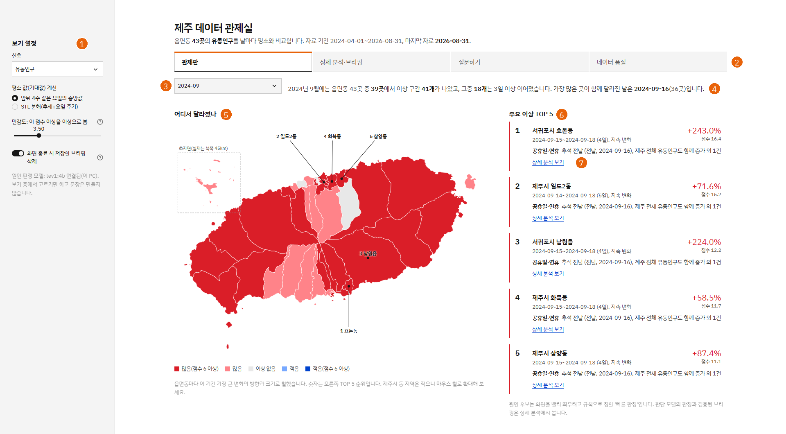
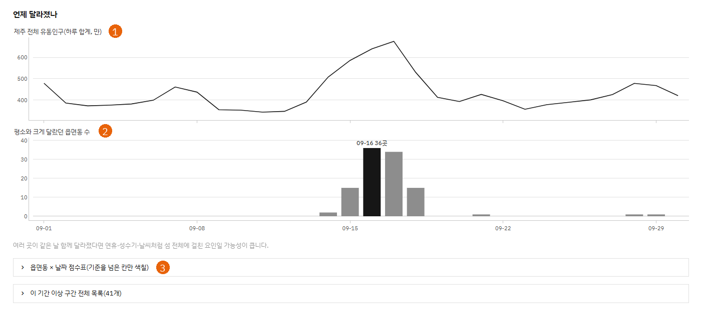
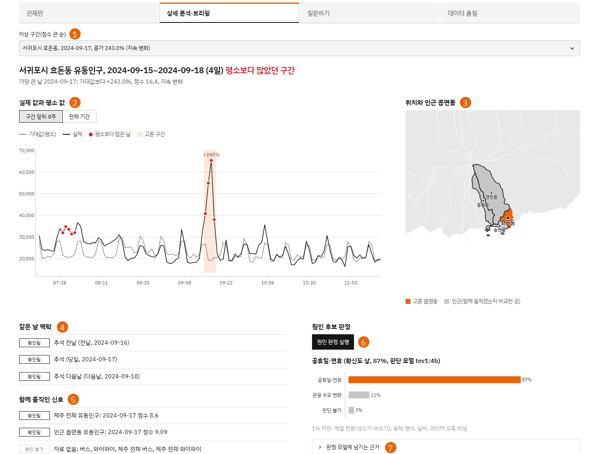
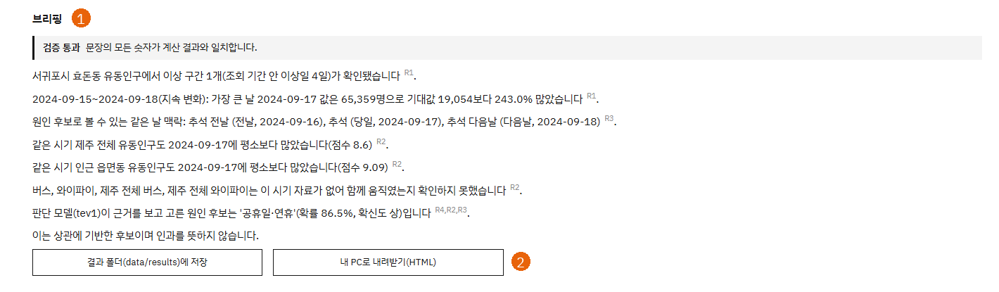
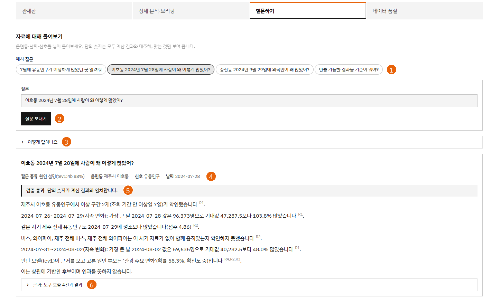
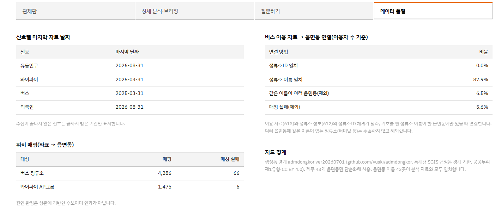

# 결과보고서 — 화면으로 보는 제주 데이터 관제실

관광·교통 이상 신호 탐지·원인 설명 AI Agent · 팀 숨비소리 · 2026-11-17

> 이 보고서의 화면은 제출본을 개발 PC에서 실행해 찍었습니다(1920×1080, 유동인구 신호, 로컬 판단 모델 tev1:4b 연결). 화면 속 동그라미 번호는 본문 설명의 번호와 같습니다. 평가 방법과 수치의 자세한 근거는 `결과_설명서.pdf`에, 설치 절차는 `설치_실행_매뉴얼.pdf`에 있습니다.

## 1. 한눈에 보기

제주 43개 읍면동의 **내국인 유동인구, 외국인 유동인구, 와이파이, 버스 이용**을 날마다 평소와 비교합니다. 평소와 크게 다른 날과 곳을 찾고, 같은 날의 공휴일·날씨·축제·입도객과 다른 신호·인근 읍면동의 움직임을 대조해 **원인 후보를 근거·확률과 함께** 보여 줍니다. 화면의 모든 숫자는 검증기가 계산 결과와 대조해 맞는 것만 보입니다.

| 구분 | 결과 |
|---|---|
| 분석 범위 | 읍면동 43곳, 신호 4종. 유동인구 2024-04-01~2026-08-31(제주데이터허브 Open API) |
| 찾은 이상 | 전체 기간 유동인구 이상 구간 581개(그중 3일 이상 이어진 지속 변화 211개), 외국인 468개 |
| 이상 탐지 성능 | 가짜 이상을 넣어 시험: 큰 변화(±80%)를 유동인구 89.6%, 버스 79.8% 찾음. 작은 변화(±20%)는 대부분 놓침 |
| 원인 판정 | 정답을 정해 둔 사례 10건 모두 맞음. 실제 이상 구간 중 공휴일·축제·강한 비바람이 확인되는 509개와 83.1% 일치 |
| 숫자 검증 | 오류 없는 문장 100% 통과, 숫자를 바꾼 문장 87.3% 차단, 지어낸 숫자 100% 차단 |
| 처리 시간 | 원인 질문 1건 약 14초(판단 모델을 CPU로 계산, 개발 PC 측정. 센터 PC 실측은 미확인) |
| 외부 전송 | 분석·질문 중 없음. 외부 AI API를 쓰지 않아 질문당 비용 0원 |

## 2. 시작하기

1. 압축을 푼 폴더에서 **`1_설치.bat`을 더블클릭**합니다(처음 한 번, 개발 PC에서 약 2분. 파이썬을 새로 설치하면 몇 분 더 걸립니다). 파이썬 3.12가 없으면 함께 든 설치 파일로 자동 설치하고, 필요한 패키지를 받습니다. Ollama가 설치되어 있으면 판단 모델(tev1:4b)도 받습니다.
2. **`2_실행.bat`을 더블클릭**합니다. 잠시 뒤 브라우저에 `http://127.0.0.1:8501` 화면이 열립니다. 실행할 때마다 데이터를 새로 계산해 화면이 다 뜨기까지 20~40초쯤 걸립니다(개발 PC 약 20초). 검은 창에도 이 안내가 나옵니다.
3. 끝낼 때는 검은 창을 닫습니다.

판단 모델이 없어도 실행됩니다. 이때는 원인 판정과 질문 분류를 규칙으로 하고, 화면 왼쪽 아래에 그렇게 표시합니다.

## 3. 관제판 — 이 기간 무엇이 달라졌나

처음 열리는 화면입니다. 아래는 2024년 9월을 고른 모습입니다.

1. **보기 설정(사이드바).** 모든 탭에 함께 적용됩니다.
   - 신호: 유동인구, 와이파이, 버스, 외국인 중 하나
   - 평소 값 계산: 앞뒤 4주 같은 요일의 중앙값(기본) 또는 STL 분해
   - 민감도: 이 점수 이상을 이상으로 봅니다(기본 3.5). 낮추면 더 작은 변화까지 잡습니다.
   - 화면 종료 시 저장한 브리핑 삭제(기본 켜짐)
   - 맨 아래 회색 글씨: 판단 모델 연결 상태
2. **탭 4개.** 관제판, 상세 분석·브리핑, 질문하기, 데이터 품질.
3. **기간 선택.** 월 단위로 고릅니다. 처음에는 데이터의 마지막 달이 선택되어 있습니다.
4. **요약 문장.** 이 기간 이상이 난 읍면동 수와 이상 구간 수, 가장 많은 곳이 함께 달라진 날을 한 문장으로 알려 줍니다. 위 화면은 "43곳 중 39곳, 이상 구간 41개, 가장 많은 날 2024-09-16(36곳)"입니다.
5. **어디서 달라졌나.** 읍면동 경계 지도입니다. 빨강은 평소보다 많음, 파랑은 적음이고, 점수 6 이상이면 진하게 칠합니다. 지도 위 숫자는 오른쪽 TOP 5의 순위입니다. 추자면은 실제로는 본섬 북쪽 약 45km에 있어 왼쪽 위 점선 상자 안에 옮겨 그렸습니다. 마우스 휠로 확대할 수 있습니다.
6. **주요 이상 TOP 5.** 점수 순으로 읍면동, 기간, 평소 대비 %, 원인 후보와 근거를 보여 줍니다. 왼쪽 막대 색이 방향입니다. 여기의 원인 후보는 화면을 빨리 띄우려고 규칙으로 정한 '빠른 판정'입니다.
7. **상세 분석 보기.** 누르면 그 구간을 상세 분석 탭에 골라 두고 "위의 '상세 분석·브리핑' 탭을 눌러 보세요"라고 안내합니다.

관제판을 아래로 내리면 **언제** 달라졌는지가 나옵니다.

1. **제주 전체 하루 합계.** 섬 전체 유동인구의 흐름입니다.
2. **평소와 크게 달라진 읍면동 수.** 날짜 축을 위 칸과 맞췄습니다. 가장 많은 날은 진하게 표시합니다. 여러 곳이 같은 날 함께 달라졌다면 연휴·성수기처럼 섬 전체에 걸린 원인일 가능성이 큽니다. 위 화면에서는 추석 전날(9월 16일) 36곳이 함께 달라졌습니다.
3. **접어 둔 표.** 읍면동 × 날짜 점수표와 이 기간 이상 구간 전체 목록입니다. 눌러서 펼칩니다.

## 4. 상세 분석·브리핑 — 왜 달라졌나

관제판에서 '상세 분석 보기'를 누른 뒤 이 탭을 열면, 그 구간이 골라져 있습니다. 아래는 TOP 1인 서귀포시 효돈동 추석 연휴 구간입니다.

1. **이상 구간 선택.** 점수가 큰 순서로 모든 이상 구간이 들어 있어 여기서 바로 바꿀 수도 있습니다.
2. **실제 값과 평소 값.** 검은 선이 실제 값, 회색 선이 평소 값(기대값)이고, 빨간 점이 평소보다 많았던 날입니다. 주황 띠가 고른 구간입니다. '전체 기간'을 누르면 자료 전체를 봅니다. 효돈동은 9월 17일에 평소의 3배가 넘었습니다(+243%).
3. **위치와 인근 읍면동.** 고른 읍면동(주황)과, 함께 움직였는지 비교한 가까운 읍면동(회색)입니다.
4. **같은 날 맥락.** 공휴일, 날씨, 축제, 입도객, 작년 같은 시기 반복을 확인한 결과입니다. '확인됨'은 그날 그런 일이 있었다는 뜻입니다. 자료가 없는 기간이면 '확인 불가'로 따로 적어, '없음'과 구분합니다.
5. **함께 움직인 신호.** 같은 날 제주 전체와 인근 읍면동, 같은 읍면동의 다른 신호가 함께 달라졌는지 봅니다. 여러 곳이 함께 움직였다면 데이터 오류보다는 실제 변화일 가능성이 큽니다.
6. **원인 판정 실행.** 누르면 로컬 판단 모델(tev1)이 왼쪽 근거만 보고 원인 보기 7개 중 하나를 고르고, 보기별 확률을 막대로 보여 줍니다. 위 화면은 '공휴일·연휴' 87%입니다.
7. **판정 모델에 넘기는 근거.** 모델이 본 문장을 그대로 펼쳐 볼 수 있습니다. 모델이 무엇을 보고 골랐는지 사람이 확인할 수 있게 하려는 것입니다.

화면 아래에는 보고서에 옮겨 쓸 수 있는 **브리핑**이 있습니다.

1. **브리핑.** 위의 계산 결과를 정해진 틀에 넣어 만든 문장입니다. 맨 위 '검증 통과'는 문장의 모든 숫자가 계산 결과와 일치한다는 뜻입니다. 문장 끝의 작은 번호(R1, R2…)는 그 숫자를 낸 계산 결과입니다. 원인 판정을 실행했으면 판정 문장과 "인과를 뜻하지 않습니다" 문장이 함께 붙습니다.
2. **저장.** '결과 폴더에 저장'은 프로그램 폴더의 `data/results`에, '내 PC로 내려받기'는 브라우저 다운로드 폴더에 HTML로 저장합니다. 저장본에는 데이터 기준일, 출처, 검증 결과가 함께 들어갑니다.

## 5. 질문하기 — 말로 묻기

메뉴를 고르는 대신 문장으로 묻는 탭입니다.

1. **예시 질문.** 누르면 아래 입력칸에 질문이 채워집니다.
2. **질문 입력과 보내기.** 질문을 쓰거나 고친 뒤 '질문 보내기'를 누릅니다. 위 화면에서는 답이 나오기까지 약 14초 걸렸습니다.
3. **어떻게 답하나요.** 답을 만드는 방식을 짧게 설명합니다.
4. **질문을 이해한 결과.** 질문 종류(판단 모델이 고른 것과 확률)와, 질문에서 읽어 낸 읍면동·신호·날짜입니다. 잘못 읽었으면 질문을 고쳐 다시 보냅니다.
5. **검증 통과.** 답의 숫자가 계산 결과와 일치합니다. 일치하지 않으면 답을 보여 주지 않고 그렇다고 알립니다.
6. **근거.** 펼치면 답을 만드는 데 쓴 계산 결과(도구 호출) 전체가 나옵니다.

위 답에서 이호동은 2024-07-26~29에 평소의 약 2배였습니다. 그 뒤 7월 31일~8월 2일 구간도 함께 찾았는데, 8월 2일은 이호테우축제 첫날입니다(축제 데이터). 판단 모델은 7월 28일 구간의 원인 후보로 '관광 수요 변화'(58.3%, 확신도 중)를 골랐습니다. 이 구간에 맞는 축제는 데이터에서 찾지 못해 실제 원인은 미확인입니다.

**물어볼 수 있는 질문**

| 종류 | 예 | 답 |
|---|---|---|
| 이상 찾기 | "7월에 유동인구가 이상하게 많았던 곳 알려줘" | 기간 안 이상 구간을 점수 순으로 |
| 원인 설명 | "송산동 2024년 9월 29일에 외국인이 왜 많았어?" | 구간, 같은 날 맥락, 동반 변화, 원인 후보와 확률. 외국인은 국적별 변화까지 |
| 문서 질문 | "반출 가능한 결과물 기준이 뭐야?" | 데이터 명세서, 허브 문서, 게시판 답변에서 찾은 내용과 출처 |
| 범위 밖 | "오늘 점심 메뉴 추천해줘" | 답할 수 있는 범위를 안내 |

연도를 빼고 물으면 데이터 기간 안의 가장 최근 해로 봅니다. 지역 없이 원인을 물으면 지역을 되묻습니다.

## 6. 데이터 품질

신호별 마지막 자료 날짜, 버스 정류소와 와이파이 AP를 읍면동에 연결한 결과(연결 실패 건수 포함), 버스 이용 자료의 읍면동 연결 비율, 지도 경계의 출처를 보여 줍니다. 예를 들어 버스 이용은 정류소 이름으로 87.9%를 연결했고, 같은 이름이 여러 읍면동에 있는 6.5%와 매칭에 실패한 5.6%는 뺐습니다. 분석 결과를 볼 때 어느 신호가 언제까지 있는지 여기서 먼저 확인합니다.

## 7. 실제 데이터로 확인한 결과

실제 데이터로 질문을 넣어 본 결과 중 일부입니다(전체 9건은 결과 설명서 4장). 확률은 실행할 때마다 조금씩 다를 수 있습니다.

| 질문 | 판단 모델이 고른 원인 후보 | 데이터로 확인되는 사실 |
|---|---|---|
| 성산읍 2024년 9월 16일 유동인구 증가 | 공휴일·연휴 80.8% | 추석 연휴(공휴일 데이터) |
| 이호동 2024년 8월 2일 유동인구 증가 | 축제·행사 59.1% | 이호테우축제 첫날(축제 데이터) |
| 송산동 2024년 9월 29일 외국인 증가 | 판단 불가 98.0% | 국적별로 일본이 변화의 73.1%. 이유(행사·크루즈 등)를 알 일 단위 자료는 없음 |
| 우도면 2025년 8월 1일 유동인구 증가 | 관광 수요 변화 68.4% | 미확인. 작년 같은 시기에도 많았음(기상·축제 자료 제공 기간 밖) |

근거가 약하면 '판단 불가'를 고르고, 근거 자료가 없는 기간이면 '확인하지 못했습니다'라고 적습니다. 원인을 지어내지 않습니다.

## 8. 이렇게 쓰면 좋습니다 — 월간 이상 신호 브리핑

1. 관제판에서 지난달을 고르고 요약 문장과 지도로 전체 그림을 봅니다.
2. '언제 달라졌나'에서 여러 곳이 함께 움직인 날(연휴 등)과 한 곳만 움직인 날을 나눠 봅니다.
3. TOP 5에서 궁금한 구간의 '상세 분석 보기'를 누르고, 상세 분석 탭에서 맥락과 동반 변화를 확인한 뒤 '원인 판정 실행'을 누릅니다.
4. 브리핑이 '검증 통과'인지 보고 HTML로 저장해 보고서 초안에 붙입니다.
5. 다른 신호(외국인, 버스 등)를 사이드바에서 바꿔 같은 순서로 봅니다. 궁금한 점은 질문하기 탭에서 문장으로 묻습니다.

## 9. 읽을 때 주의할 점

- **원인은 '후보'입니다.** 같은 날 일어난 일과 함께 움직인 신호를 근거로 고른 것이며, 인과를 뜻하지 않습니다. 모든 답의 끝에 이 문장을 붙입니다.
- **근거 자료 기간이 신호보다 짧습니다.** 기상·축제 자료는 2025-03, 입도객은 2025-07까지만 있습니다. 와이파이는 2024-10~2025-03, 버스는 2025-01~03만 있습니다. 그 밖의 날짜는 '확인 불가'로 표시합니다.
- **외국인 유동인구는 2025년 4·5월이 비어 있습니다.** 허브 원천 자료 오류로 받을 수 없었습니다.
- **작은 변화는 놓칠 수 있습니다.** 평소 대비 ±20% 정도의 변화는 대부분 잡지 못합니다. 민감도를 낮추면 더 잡지만 경보도 늘어납니다.
- **관제판 TOP 5의 원인 후보는 빠른 판정입니다.** 판단 모델의 판정은 상세 분석 탭에서 '원인 판정 실행'을 눌러 확인합니다.
